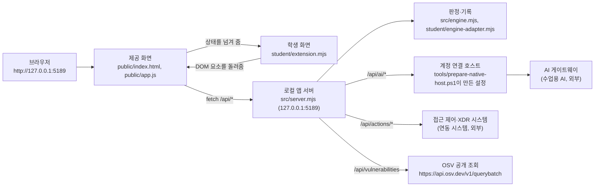

# stoneAgent 학생 실행 설명서

이 문서는 stoneAgent(내 보안 Agent) 프로젝트를 처음 보는 사람이 자기 PC에서 실행하고,
어디까지가 제공 코드이고 어디부터가 학생이 작성한 부분인지 확인할 수 있도록 쓴 설명서입니다.

- 제공 문서(`docs/` 아래 나머지 파일)와 `README.md`는 수정하지 않았습니다. 이 문서만 새로 추가했습니다.
- 이 문서의 경로·명령·버튼 이름은 이 저장소의 실제 파일에서 확인한 값입니다. 확인하지 못한 항목은 "미확인"으로 적었습니다.
- 열쇠·토큰·비밀번호는 이 문서에 적지 않습니다. 비밀 없는 설정 예시는 `on-client/.env.example`에 있습니다.

## 1. 목적과 기능

stoneAgent는 회사 직원이 **자기 자신의** 보안 상태를 확인하는 화면입니다.

| 화면 | 보여 주는 것 |
|---|---|
| 보호 현황 | 로그인 사용자·기기·세션, 알림, 기기/세션 목록, 도움정보, AI 연결 점검, 설치 패키지 조회 |
| 업무 앱 | 업무 앱 접속 요청과 그 판정(허용·거부·추가 확인·확인 불가) |
| 보안 기록 | 본인의 최근 접속 기록과 저장된 XDR 경보, 기록별 상세·AI 설명·조치 상태 |

조회 범위에 한계가 있습니다. 보안 기록은 본인의 최근 40건까지이고, 세션은 지금 검증된 연결 하나만 옵니다.
모든 직원의 전체 이력이나 실시간 전체 위협 탐지가 아닙니다.

## 2. 지원 환경과 확인한 버전

| 항목 | 값 | 확인 방법 |
|---|---|---|
| Node.js | 24.19.0 (`package.json`의 `engines.node`) | `node -v` → `v24.19.0` 확인함 |
| 외부 npm 의존성 | 없음 (`package.json`에 `dependencies` 없음) | `package.json` |
| 운영체제 | Windows + PowerShell (실행 스크립트가 `.ps1`) | — |
| 포트 | 5189 (`.env.example`의 `ON_PORT`, 변경하려면 `-Port`) | — |
| 브라우저 주소 | http://127.0.0.1:5189 | — |

`tools/start-alekov.ps1`은 Node.js가 `v24.19.0`이 아니면 "참고: 지금 Node.js 는 … 입니다. 수업 기준은 v24.19.0 입니다."라고 알려 주고 계속 진행합니다.

지원하지 않거나 확인하지 않은 환경: macOS·Linux(실행 스크립트가 PowerShell 전용), 다른 Node.js 메이저 버전, 원격 서버 배포. 확인하지 않았습니다.

## 3. 폴더 구조

```
stoneAgent/                     <- Git 최상위. PowerShell에서 git 명령을 실행하는 위치
├─ on-client/                   <- 13~22단계 앱. 서버를 켜는 위치
│  ├─ package.json              name: alekov-client-starter, version 0.2.11
│  ├─ .env.example              비밀 없는 설정 예시
│  ├─ README.md                 제공 문서 (수정하지 않음)
│  ├─ docs/                     제공 문서 + STUDENT_RUNBOOK.md(이 문서)
│  ├─ public/                   제공 화면 (index.html, app.js, style.css 등)
│  ├─ src/                      제공 서버 (server.mjs, engine, ai, actions, connection, vulnerabilities)
│  ├─ student/                  학생이 고치는 폴더
│  │  ├─ extension.mjs          ★ 13~20단계에서 작성한 파일
│  │  └─ engine-adapter.mjs     판정 어댑터 (이번 단계들에서 수정하지 않음)
│  ├─ tools/                    start-alekov.ps1, prepare-native-host.ps1 등
│  └─ vendor/                   제공 번들
└─ (1~12단계와 보너스 xdr 파일들)   이전 차수 작업. 지우거나 덮어쓰지 않음
```

## 4. 실행 절차

### 4.1 서버 켜기

PowerShell을 **`on-client` 폴더**에서 엽니다.

```powershell
cd "<프로젝트 경로>\stoneAgent\on-client"
node -v
powershell -NoProfile -ExecutionPolicy Bypass -File .\tools\start-alekov.ps1
```

| 모드 | 명령 | 쓰는 때 |
|---|---|---|
| 기본 | `.\tools\start-alekov.ps1` | 실제 연결 상태를 확인할 때 |
| 예제 자료 | `.\tools\start-alekov.ps1 -Demo` | 화면 구성을 확인할 때. 실제 연결이나 성취가 아님 |
| 계정 연결 사용 | `.\tools\start-alekov.ps1 -NativeHostConfig "<호스트 설정 파일 경로>"` | 계정 연결 확인을 쓸 때 |
| 포트 변경 | `.\tools\start-alekov.ps1 -Port 5200` | 5189가 쓰이고 있을 때 |

`npm start`(기본), `npm run demo`(예제), `npm run check`(문법 검사)도 같은 서버/검사를 실행합니다.

### 4.2 정상 시작 신호

스크립트가 아래 두 줄을 출력하면 켜진 것입니다.

```
케셰브 연결 확인: http://127.0.0.1:5189
케셰브가 켜졌습니다. 브라우저에서 http://127.0.0.1:5189/ 을 여세요.
서버가 응답한 것만 확인했습니다. AI 연결 상태는 화면에서 따로 확인해 주세요.
끄려면 이 창에서 Ctrl+C 를 누르세요.
```

첫 줄은 서버 자체 로그입니다. 예제 모드로 켜면 `케셰브 예제: http://127.0.0.1:5189`로 나옵니다.
**이 메시지는 서버가 응답했다는 뜻일 뿐, AI 연결이나 단계 통과를 뜻하지 않습니다.**

### 4.3 브라우저에서 보기

http://127.0.0.1:5189 를 엽니다. 왼쪽 메뉴 「보호 현황」·「업무 앱」·「보안 기록」은 마우스와 Tab·Enter, 위아래 방향키로 이동합니다.

### 4.4 끄기와 다시 켜기

- 끄기: 서버를 켠 PowerShell 창에서 `Ctrl + C`
- 다시 켜기: 같은 폴더에서 4.1의 명령을 다시 실행하고, 브라우저에서 `F5`
- `-Background`로 켰다면 창을 닫아도 꺼지지 않습니다. 출력된 프로세스 번호의 `node`를 작업 관리자에서 종료합니다.

## 5. 시스템 구성도

### 5.1 Mermaid



### 5.2 같은 내용을 글로

1. 사용자는 브라우저로 `http://127.0.0.1:5189`를 엽니다.
2. 제공 화면(`public/app.js`)이 로컬 앱 서버의 `/api/*`를 호출하고, 받은 결과를 학생 함수에 넘깁니다. 학생 함수는 DOM 요소를 돌려줄 뿐 직접 요청하지 않습니다.
3. 로컬 앱 서버(`src/server.mjs`)는 `127.0.0.1`에서만 듣습니다. 외부에 열리지 않습니다.
4. 접근 판정과 보안 기록은 서버의 엔진(`src/engine.mjs`, `student/engine-adapter.mjs`)이 담당합니다.
5. AI 요청(`/api/ai/check`, `/api/ai/explain`)은 앱 서버를 거쳐 AI 게이트웨이로 갑니다. 브라우저에서 주소나 열쇠를 입력하지 않습니다.
6. 조치(`/api/actions/prepare|execute|result`)는 앱 서버를 거쳐 연동 시스템으로 갑니다.
7. 패키지 조회(`/api/vulnerabilities`)는 `package-lock.json`과 설치 메타데이터를 대조하고, 담당자가 허용한 공개 패키지만 OSV에 조회합니다.

### 5.3 경로 표

| 화면 동작 | 호출 경로 | 학생 함수 |
|---|---|---|
| 화면 열기·다시 불러오기 | `/api/me`, `/api/apps`, `/api/events`, `/api/devices`, `/api/sessions` | `renderIdentity`, `renderEvents`, `renderStatus` |
| 업무 앱 접속 요청 | `/api/access` | `renderDecision` |
| 도움정보 불러오기 | `/api/diagnostics` | `renderStatus` |
| AI 연결 점검 | `/api/ai/check` | `renderAiConnection` |
| AI 설명 요청 | `/api/ai/explain` | `renderExplanation` |
| 조치 준비·집행·결과 재조회 | `/api/actions/prepare`, `/execute`, `/result` | `renderAction` |
| 설치 패키지 조회 | `/api/vulnerabilities` | `renderVulnerabilities` |

## 6. 제공 부분과 학생 작성 부분

| 구분 | 파일 | 내용 |
|---|---|---|
| 제공 | `public/`, `src/`, `tools/`, `vendor/`, `docs/`(이 문서 제외), `README.md` | 화면 틀, 서버, 판정, 연결, 검증. 수정하지 않음 |
| 학생 작성 | `student/extension.mjs` | 아래 8개 함수 |
| 학생 작성 | `docs/STUDENT_RUNBOOK.md` | 이 문서 |

`createStudentView(context)`가 돌려주는 함수:

| 함수 | 단계 | 하는 일 |
|---|---|---|
| `renderIdentity` | 13 | 사용자·기기·세션을 상태별로 표시 |
| `renderDecision` | 14 | 업무 앱 접속 판정과 이유·시각 표시 |
| `renderEvents` | 15 | 기록 목록, 세 가지 필터, 상세(`data-student-event-id`, `data-student-event-detail`) |
| `renderStatus` | 16 | 알림·기기·세션·도움정보, 「도움정보 복사」 버튼 |
| `renderAiConnection` | 17 | AI 연결 점검 결과와 원인별 실패 안내 |
| `renderExplanation` | 17·18 | AI 설명을 근거·규칙·상태와 연결 (`data-student-explanation-event`) |
| `renderAction` | 19 | 조치 상태 표시 (`data-student-action-event`, `data-student-action-request`) |
| `renderVulnerabilities` | 20 | 설치 패키지와 OSV 조회 결과 (`data-student-package-name`, `data-student-package-version`) |

학생 함수는 서버에 직접 요청하지 않고, 버튼으로 조치를 실행하지 않으며, `innerHTML`을 쓰지 않습니다.

## 7. 장애 상황과 확인 순서

| 증상 / 코드 | 뜻 | 확인·복구 |
|---|---|---|
| 브라우저가 열리지 않음 | 서버가 꺼졌거나 포트가 다름 | PowerShell 창의 시작 메시지 확인, `-Port`로 바꿨다면 그 주소로 접속 |
| 화면에 「연결 없음」 | 기본 모드에서 연동 시스템에 연결되지 않음 | 정상 상태. 화면 구성만 볼 때는 `-Demo` |
| `로컬 서버에 연결할 수 없습니다` | 앱 서버가 꺼짐 | 서버를 다시 켜고 「다시 불러오기」를 직접 누름. 자동 재요청 없음 |
| `NATIVE_HOST_DISABLED` | 이 실행에 계정 연결 설정이 없음 | `-NativeHostConfig`로 설정 파일 경로를 주고 다시 켜기 |
| `ALEKOV_CONNECT_RESPONSE_INVALID` | 연결 완료 아님 | 「상태 다시 확인」 후에도 같으면 「연결 도움정보 보기」 내용을 담당자에게 전달 |
| `ON_AI_PROVISIONING_PENDING` | 앱 이용 권한 준비 중 | 학생 코드 문제가 아님. 담당자에게 확인 |
| `WB_CLCO_RATE_LIMITED` / `TIMEOUT` | 요청 제한·시간 초과 | 잠시 뒤 「AI 연결 점검」을 직접 다시 누름 |
| `PROJECT_NOT_CONFIGURED` / `NO_APPROVED_PACKAGES` | 패키지 조회 대상 설정 없음 | 정상. 취약점 없음이 아님. 담당자가 허용 목록을 준비 |
| PowerShell에서 한글 경로 오류 | 콘솔 인코딩 | `[Console]::OutputEncoding = [System.Text.Encoding]::UTF8` 실행 후 재시도 |

오류 코드별 전체 표는 `docs/CONNECTION_TROUBLESHOOT.md`에 있습니다.

## 8. 확인한 것과 확인하지 못한 것

### 실제 화면에서 확인

| 항목 | 결과 |
|---|---|
| 13단계 사용자·기기·세션 표시, 다시 불러오기, 서버를 끈 뒤 실패 표시 | 확인 |
| 14단계 허용·거부·추가 확인 판정과 요청 실패 구분 | 확인 |
| 15단계 기록 목록·상세, 다시 불러오기 뒤 상세 초기화 | 확인 |
| 16단계 알림·기기·세션, 도움정보 여섯 값 표시와 복사, 자동 재요청 없음 | 확인 |
| 17단계 점검 전 상태와 점검 실패 안내 | 확인 |
| 18단계 AI 설명 실패 시 기록·업무 앱 판정이 그대로 동작 | 확인 |
| 19단계 지원 조치 없음 → 「아직 미실행(idle)」 | 확인 |
| 20단계 `not_configured` 표시, 다시 조회 시 새 요청 | 확인 |

### 모의 입력으로만 점검 (실제 화면 미확인)

- 13단계 사용자 교체, 14단계 `unknown` 판정
- 15단계 여러 건에서의 필터, 빈 배열, 형식 불일치
- 16단계 빈 목록, 시간 초과, 미지원 조치 버튼
- 17단계 `ok(test/verified)`, 오류 코드 분류
- 18단계 설명 성공 화면, 근거 불일치 거부
- 19단계 `prepared`~`expired` 전 상태
- 20단계 `complete`·`partial`·`unverifiable`과 패키지 행

### 미확인

- AI 연결 완료와 실제 사건 설명 호출. `ALEKOV_CONNECT_RESPONSE_INVALID`로 연결이 되지 않았습니다.
- 실제 조치 준비·집행·결과 재조회. 지금 기록의 `supportedActions`가 비어 있습니다.
- OSV 실제 조회 결과와 `package-lock.json` 버전 대조. 허용 목록이 비어 있습니다.
- 패키지 조회 취소. 응답이 즉시 끝나 `loading` 구간에서 버튼을 누를 수 없었습니다.
- Windows 외 운영체제, Node.js 24.19.0 외 버전.

확인하지 않은 동작을 확인했다고 적지 않았습니다.
